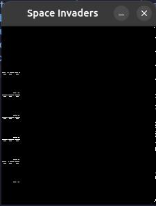

# Current List of Issues

- Stuck in an infinite loop in `ClearScreen` (`0x1A5C` to `0x1A68`). The JNZ seems never to fire.
  - Not actually an issue! 
  - There's just a lot of screen to clear (lots of opcodes to run through) and I hadn't reached the end of it (all the `printf()` I/O probably didn't help with the running time...)
- Weird drop into `0x00C5` (which isn't a real instruction location) at some point
  - I wonder if this is my VBlank interrupts screwing up.
  - Because it's not in the normal flow of code - nothing's JMPing or CALLing to there
  - Previous instructions are like, `LDAX D` and such, up in the `0x0A...` sorts of ranges.
  - This could be what's currently breaking things.
  - YUP! this is from an interrupt:
    - Debug logging shows

```
Generating interrupt 215
0x00C5 RZ
```

    - This must be the vblank interrupts then.
    - `215` is 0xD7
    - I think the address of the RST is being calculated incorrectly. SHould be fixed now?
    - It is. It's going into the correct RST routine now (though I need the middle-of-vblank one too)
- Interestingly, it appears the VBlank interrupts are getting in-phase with the execution of the code so that the code doesn't actually progress (printf'ing seeming to take > 1/60 s ?) 
  - Disabling debug appears to fix that so, yeah.
- Now: issue is that inputs appear to try to write to ROM at address `0x0000`!
  - OK now it's some decrementing address? 
  - we seem to be getting down into the RSTs and then back out to non-instruction places?
  - maybe it's `PUSH`ing to bad stack places?
  - Looks like the stack pointer might be going bad
  - Then looks like  it might be `RET`ing to bad places as a result.
  - Maybe I have something like wrong number of bytes assigned to the IN/OUT opcodes or something
  - Looks like I assigned the wrong reserved addresses for ROM
- Now we're getting..._something_ on screen, but it's just a line of pixels
  - Check that I'm rendering the framebuffer correctly
  - It's rendering one line of X but seems not to be iterating in y or something? if x loops 0-224, then it sets 224 pixels; if x goes 0-256, then it sets 256 of them.
  - I think this is going wrong because of the whole 8-bits-per-pixel thing
  - Some debug logging makes me think the conversion of uint8 --> bool isn't working how I thought?
    - Does 01101011 as a uint8 NOT convert to 8 bools of values (false, true, true, false, true, false, true, true)?
- OK so I'm going to have to track progress by printing when we hit key locations in the code
- Also I really need to validate this framebuffer thing.
  - Test buffer of alternating pixels (buffer of bytes equal to `0b01010101` = `0x55`).
  - OK so the test buffer shows that, given a framebuffer, the code should work to render it
- OK so now I've made a little change to the framebuffer pipeline, and it's rendering some weird lines...
  - But it looks like it's at least _trying_ to render stuff.
  - It seems to be responding to inputs (I see a pixel toggling when I press Space, a different one when pressing A, different when pressing D, etc)




- With some help from the Emulator101 code, I have it...ish-working in demo mode?!
  - what I have is like, eight mini-versions of space invaders, rendered sideways, on the screen.
  - But it's there!